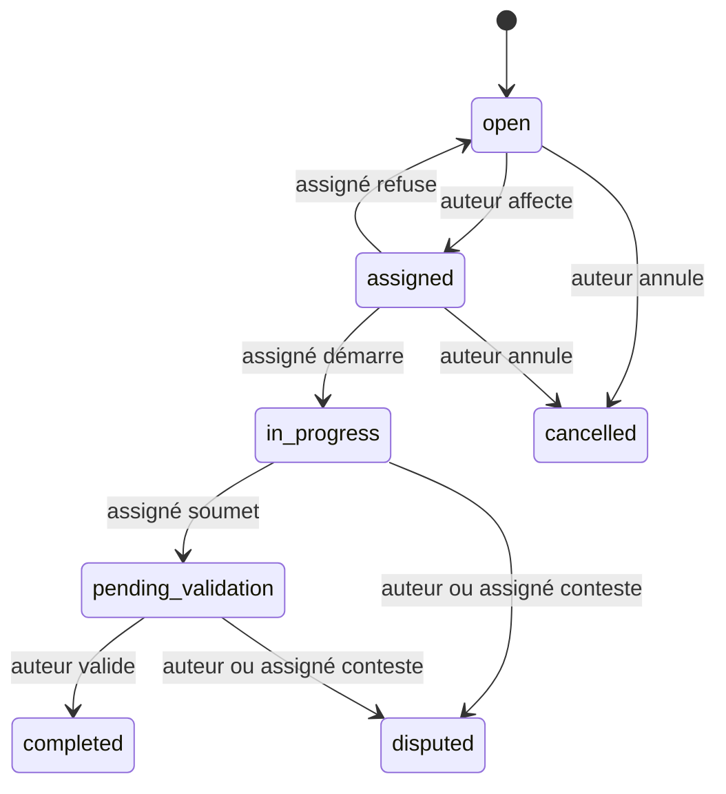

# Mission — guide autonome du moteur

**Mission :** formaliser une tâche ou un engagement avec un auteur, un assigné unique, une récompense éventuelle, une échéance et un résultat à valider.  
**Périmètre actuel :** modèle local Dexie, repository, logique de transitions, outbox de synchronisation et garde-fous PostgreSQL.  
**Important :** le code établit un domaine métier et une machine d'état, mais l'inventaire de cette branche ne montre pas encore d'API REST ni d'écran/route Mission dédiés.

## 1. Mission et valeur métier

Mission gère le cycle de réalisation d'une tâche entre un auteur (propriétaire de la demande) et un membre assigné. Elle est propriétaire de l'affectation, de l'avancement, de la validation, de l'annulation et de l'état de litige.

Le modèle courant est volontairement simple : un seul auteur et au plus un assigné. Il ne comprend pas encore de candidatures multiples, d'équipes, de jalons, de livrables ou de pièces justificatives structurées.

## 2. Parcours utilisateur de bout en bout

### 2.1 Créer une mission

1. Un utilisateur authentifié ouvre une mission.
2. Il fournit un titre, un brief, un montant de récompense et éventuellement une échéance.
3. Le repository déduit l'auteur du scope local actif ; il n'accepte pas un auteur choisi par le client.
4. La mission est initialisée à `open`, sans assigné, avec la devise `XAF` par défaut.
5. Le record est écrit dans IndexedDB et une mutation est placée dans l'outbox dans la même transaction.
6. La synchronisation serveur intervient ensuite. Une sauvegarde locale n'est pas une confirmation distante.

Un scope invité (`guest:…`) est refusé pour les actions Mission.

### 2.2 Modifier avant affectation

Seul l'auteur peut modifier titre, brief, récompense, devise et échéance, et uniquement lorsque le statut est `open` et `assigneeId` nul. Les champs d'identité, d'enveloppe et de cycle de vie ne sont pas modifiables via une mise à jour générique.

### 2.3 Affecter et exécuter

1. L'auteur affecte un autre membre à une mission ouverte.
2. L'état passe à `assigned`.
3. L'assigné peut refuser : retour à `open`, assignee remis à `null`.
4. L'assigné peut démarrer : passage à `in_progress`.
5. Après réalisation, l'assigné soumet : passage à `pending_validation`.
6. L'auteur valide : passage à `completed`.
7. L'auteur ou l'assigné peut signaler un litige depuis `in_progress` ou `pending_validation`, passage à `disputed`.

Le dépôt actuel ne stocke pas de champ résultat/preuve dédié : la soumission est une transition de statut.

### 2.4 Annuler, supprimer et échéance

- L'auteur annule depuis `open` ou `assigned`, sans changer l'assigné lors de l'annulation.
- La suppression est logique (`deletedAt`) et non physique. La base exige une mission ouverte et sans assigné.
- `isMissionOverdue` signale une échéance passée sauf pour `completed`, `cancelled` et `disputed`. Aucun ordonnanceur de relance/expiration n'est établi par les sources présentes.

## 3. Machine d'état

Les états terminaux sont `completed`, `disputed` et `cancelled`. `draft`, `published`, `archived` et `deleted` ne sont pas des statuts de la machine courante ; la suppression est portée par `deletedAt`.

| Action | Acteur autorisé | Transition |
|---|---|---|
| `assign(assigneeId)` | auteur, cible différente de l'auteur | open → assigned |
| `decline()` | assigné | assigned → open |
| `start()` | assigné | assigned → in_progress |
| `submitResult()` | assigné | in_progress → pending_validation |
| `validateResult()` | auteur | pending_validation → completed |
| `dispute()` | auteur ou assigné | in_progress/pending_validation → disputed |
| `cancel()` | auteur | open/assigned → cancelled |

Toute transition non listée est refusée.

## 4. Règles métier et invariants

- Un seul auteur, au plus un assigné.
- L'auteur ne peut pas s'assigner lui-même.
- Seul l'auteur peut assigner, annuler ou valider.
- Seul l'assigné peut refuser, démarrer ou soumettre.
- Auteur et assigné peuvent ouvrir un litige dans les états prévus.
- Les détails sont modifiables uniquement avant affectation.
- Une transition d'état ne peut pas modifier simultanément les détails métier.
- Les champs `id`, `author_id` et `created_at` sont immuables côté client.
- Les changements de statut sont audités en base.
- La suppression physique est interdite aux clients authentifiés.

## 5. Architecture et composants

| Composant | Responsabilité |
|---|---|
| `packages/core-contracts/src/records.ts` | `MissionRecord`, `MissionStatus`, `MissionAction` |
| `packages/core-contracts/src/write-policy.ts` | Champs de mise à jour directe vs champs réservés aux commandes |
| `packages/core-logic/src/missions.ts` | Transitions, droits d'édition/suppression, retard, tri par échéance |
| `packages/core-db/src/mission-repository.ts` | API locale `missionsRepository`, authentification locale, commandes |
| `packages/core-db/src/schema.ts` | Table Dexie `missions`, isolation du scope local |
| `packages/core-db/src/outbox.ts` | Persistance des mutations hors ligne et reprise/quarantaine |
| `supabase/migrations/20261113004000_secure_mission_transitions.sql` | Contraintes, privilèges, RLS, trigger de transitions, audit, index |

La base locale est la source de lecture de l'interface. Le sync worker est le seul pont réseau. Le repository écrit le record et son entrée outbox dans une transaction Dexie.

## 6. Modèle de données

`MissionRecord` comprend :

- `id: MissionId`
- `authorId: UserId`
- `assigneeId: UserId | null`
- `title: string` (SQL : 1–160 caractères trimés)
- `brief: string` (SQL : 1–4 000 caractères trimés)
- `status: MissionStatus`
- `rewardAmount: number` (SQL : non négatif)
- `rewardCurrency: string` (SQL V1 : `XAF`)
- `dueAt: number | null` (millisecondes epoch)
- `createdAt`, `updatedAt`, `revision`, `deletedAt` via `BaseRecord`

## 7. Persistance, sécurité et synchronisation

La write policy autorise la création, les mises à jour directes de `title`, `brief`, `rewardAmount`, `rewardCurrency`, `dueAt`, les commandes de statut/assigné via la machine d'état, et la suppression logique.

La migration du 13 novembre 2026 :
- vérifie les données existantes avant de poser les contraintes, sans les normaliser silencieusement ;
- limite les statuts et les valeurs de titre/brief/récompense ;
- impose l'auteur à l'insertion et restreint les mises à jour RLS à l'auteur ou à l'assigné ;
- protège les transitions dans un trigger SECURITY INVOKER ;
- audite les changements de statut avec un trigger SECURITY DEFINER à search_path borné ;
- interdit UPDATE générique et DELETE physique aux clients authentifiés.

Le rôle `service_role` est explicitement traité comme opération de confiance. Il ne doit pas être exposé au client.

## 8. API disponible et contrat historique

L'API actuellement prouvée par le code est le repository local `missionsRepository` : `get`, `list`, `create`, `editDetails`, `assign`, `decline`, `start`, `submitResult`, `validateResult`, `dispute`, `cancel`, `remove`.

Le fichier historique `7. Mission API.md` propose des routes REST telles que `POST /missions`, `GET /missions/{id}`, `join`, `leave`, `publish` et `archive`. Ces routes et ces états (`Draft/Published/Archived`) ne correspondent pas à la machine d'état actuelle et aucune implémentation REST dédiée n'a été identifiée. Les traiter comme propositions historiques, pas comme endpoints actifs.

## 9. Tests et état de validation

- `tests/mission-transitions.test.ts` : trois tests unitaires existants.
- `supabase/tests/database/123_mission_state_machine.test.sql` : 23 assertions structurelles pgTAP.
- Les fichiers de test n'ont pas été exécutés dans le cadre de cette mise à jour documentaire.

Compléter la couverture par des tests de chaque transition, des rôles auteur/assigné/tiers avec JWT réels, des refus RLS, des courses concurrentes, des échecs de sync, de l'isolation multi-comptes et des bornes de validation.

Un écart connu doit être résolu : `canRemoveMission` autorise localement auteur + statut open, tandis que le trigger SQL exige aussi `assignee_id IS NULL`. La règle locale doit être alignée sur la base.

## 10. Limites et évolutions non démontrées

Ne pas annoncer comme actives sans nouveaux éléments de code : route/UI dédiée, API REST, publication publique, candidatures multiples, notifications, commentaires, pièces jointes, preuve de résultat, jalons, livrables, archivage, intégrations événementielles Mission.

## 11. Documentation autonome

- [Spécification fonctionnelle](FUNCTIONAL_SPEC.md)
- [Architecture technique](TECHNICAL_ARCHITECTURE.md)
- [Contrat API et synchronisation](API_AND_SYNC_CONTRACT.md)
- [Tests et sécurité](TESTING_AND_SECURITY.md)
- [Contrat API historique conservé](7.%20Mission%20API.md)

Ce guide rassemble la vue d'ensemble nécessaire pour comprendre Mission sans lire la documentation d'un autre moteur.
