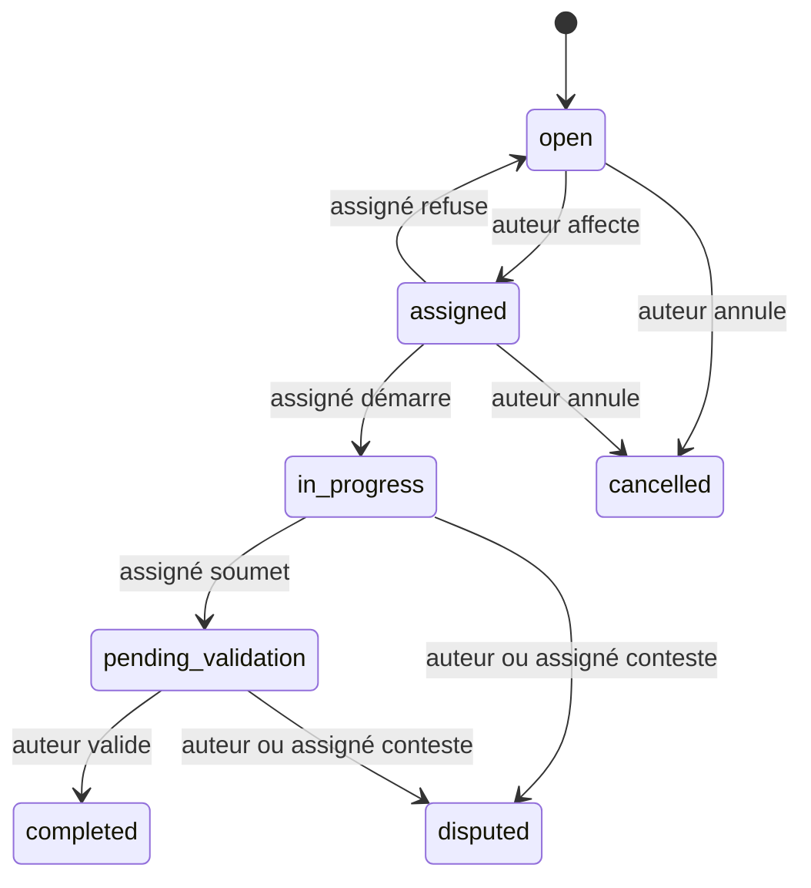

# Mission — spécification fonctionnelle V1

> Ce document décrit le comportement métier de Mission à partir des contrats et du code présents dans le dépôt. Il distingue les capacités implémentées des intentions historiques non démontrées.

## 1. Finalité et promesse

Mission transforme une demande structurée en engagement réalisable entre un auteur (qui porte l'objectif) et, au maximum dans le modèle actuel, un membre assigné (qui réalise le travail). La mission décrit le résultat attendu, les instructions, une éventuelle récompense et une échéance.

Mission n'est ni un message éphémère, ni une publication sociale, ni un moteur de recommandation. Elle conserve l'autorité sur son affectation, son avancement, sa validation et son statut.

## 2. Acteurs et responsabilités

| Acteur | Responsabilités confirmées |
|---|---|
| Auteur | Créer, modifier les détails tant que la mission est ouverte et non assignée, assigner un membre, annuler dans les états autorisés, valider le résultat, supprimer logiquement une mission ouverte |
| Assigné | Refuser une affectation, démarrer le travail, soumettre le résultat, signaler un litige |
| Autre membre | Aucun droit de mutation n'est accordé par la machine d'état décrite |
| Service de confiance (service role) | Les opérations privilégiées sont explicitement séparées dans le trigger SQL ; leur usage métier n'est pas défini ici |

Le modèle courant ne comporte qu'un seul champ `assigneeId`. Les candidatures multiples, listes de participants, rôles observateur/chef d'équipe et sous-missions ne sont donc pas des capacités V1 prouvées.

## 3. Données métier

Une Mission contient :

- `id` : identifiant stable ;
- `authorId` : auteur/propriétaire ;
- `assigneeId` : assigné ou `null` ;
- `title` : titre, 1 à 160 caractères après trim selon la contrainte SQL ;
- `brief` : description/instructions, 1 à 4 000 caractères après trim ;
- `status` : état de la machine V1 ;
- `rewardAmount` : montant numérique non négatif ;
- `rewardCurrency` : `XAF` dans le contrat SQL actuel ;
- `dueAt` : échéance en millisecondes epoch ou `null` ;
- enveloppe de synchronisation : `createdAt`, `updatedAt`, `revision`, `deletedAt`.

Aucun champ de critères de réussite structurés, pièces jointes, jalons ou livrables n'existe dans le type `MissionRecord` actuel. La validation porte donc sur le changement d'état, pas sur une grille de preuve formalisée.

## 4. Parcours utilisateur

### 4.1 Création

1. Le membre doit être authentifié : le dépôt local refuse les actions Mission depuis un propriétaire de base identifié comme invité.
2. Il renseigne titre, brief, montant de récompense et échéance facultative.
3. Le dépôt fixe l'auteur à partir du propriétaire local actif, l'assigné à `null`, le statut à `open` et la devise par défaut à `XAF`.
4. Le record est écrit dans IndexedDB et une mutation est ajoutée à l'outbox dans la même transaction.
5. La synchronisation distante est asynchrone ; une création locale ne prouve pas à elle seule que le serveur l'a acceptée.

### 4.2 Édition avant affectation

L'auteur peut modifier titre, brief, récompense, devise et échéance uniquement lorsque le statut est `open` et qu'aucun assigné n'est défini. Les champs d'identité, l'état et l'enveloppe de synchronisation ne sont pas des champs d'édition générique.

### 4.3 Affectation et réalisation

1. L'auteur affecte un autre utilisateur à une mission ouverte sans assigné.
2. L'état devient `assigned`.
3. L'assigné peut refuser : retour à `open`, assigné effacé.
4. S'il accepte en commençant, l'état devient `in_progress`.
5. L'assigné soumet le résultat : `pending_validation`.
6. L'auteur valide : `completed`.
7. L'auteur ou l'assigné peut signaler un litige depuis `in_progress` ou `pending_validation`, ce qui mène à `disputed`.

La soumission et la validation sont des transitions de statut. Le code courant ne transporte pas de pièce jointe ou de contenu de résultat dédié.

### 4.4 Annulation, suppression et échéance

- L'auteur peut annuler depuis `open` ou `assigned`, en conservant l'assigné existant le cas échéant.
- La suppression est une suppression logique, réservée à l'auteur d'une mission `open`. La logique TypeScript `canRemoveMission` n'exige pas explicitement `assigneeId === null`, alors que le trigger SQL de suppression exige l'absence d'assigné : la base est plus restrictive et fait autorité.
- Une mission dont `dueAt` est passé est signalée en retard par `isMissionOverdue`, sauf si elle est `completed`, `cancelled` ou `disputed`. Cette fonction est un calcul local ; aucun ordonnanceur de relance/expiration n'est établi par les sources examinées.

## 5. Machine d'état de référence

Les états terminaux observés sont `completed`, `disputed` et `cancelled`. Le modèle ne contient pas `draft`, `published`, `archived` ou `deleted` comme statuts : la suppression est représentée par `deletedAt`.

## 6. Invariants fonctionnels

- L'auteur ne peut pas s'assigner lui-même.
- Une mission ne peut avoir qu'un seul assigné.
- Seul l'auteur peut assigner, annuler ou valider.
- Seul l'assigné peut refuser, démarrer ou soumettre.
- Auteur et assigné peuvent ouvrir un litige dans les deux états actifs prévus.
- Une transition de statut ne peut pas modifier simultanément les détails métier.
- Les détails sont verrouillés après affectation.
- Les changements d'état sont inscrits dans la table d'audit par le trigger SQL.
- La suppression physique est interdite aux clients authentifiés.

## 7. Visibilité et confidentialité

La migration de sécurité documente une politique de lecture « missions readable by members » déjà présente et des droits de mutation auteur/assigné. La définition exacte de cette politique de lecture dépend de la migration qui l'a créée ; il ne faut pas déduire que toutes les missions sont publiques. Le client doit présenter uniquement les données que le backend autorise.

Le périmètre ne documente pas de partage public, de recherche géographique, de candidature anonyme ou de divulgation de profil.

## 8. Hors périmètre / non démontré

Ne pas annoncer comme actifs sans implémentation supplémentaire : publication publique, brouillons métier distincts de l'état `open`, candidatures multiples, invitations, capacité maximale, sélection de candidatures, commentaires, pièces jointes, jalons, livrables, notation, notifications, archivage, endpoints REST dédiés et intégration événementielle sortante.

## 9. Critères d'acceptation

Une version fonctionnelle conforme doit démontrer : création authentifiée avec auteur imposé ; validation des champs ; édition avant affectation seulement ; affectation à un autre membre ; refus ; démarrage ; soumission ; validation ; litige par chaque partie ; annulation ; suppression logique limitée ; isolation entre comptes ; audit des transitions ; fonctionnement hors ligne avec reprise de synchronisation et affichage explicite des échecs permanents.
